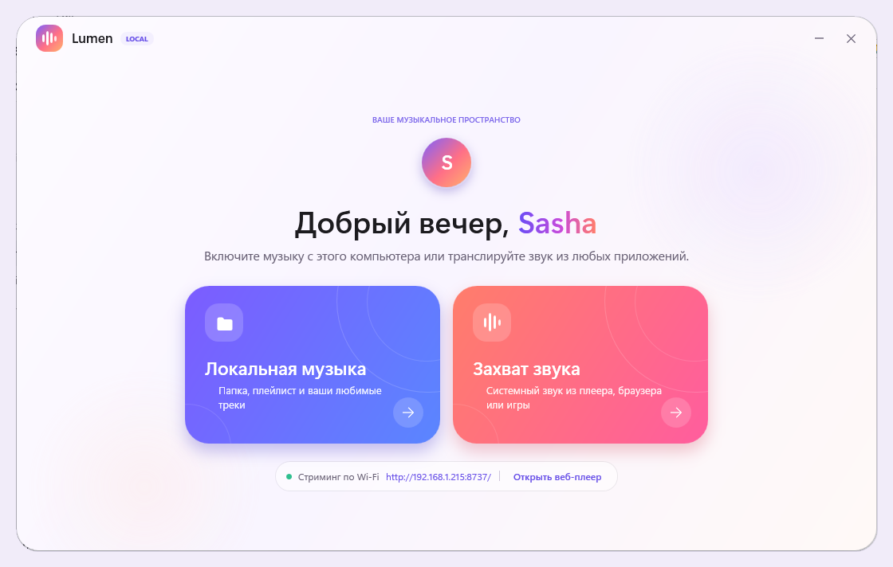
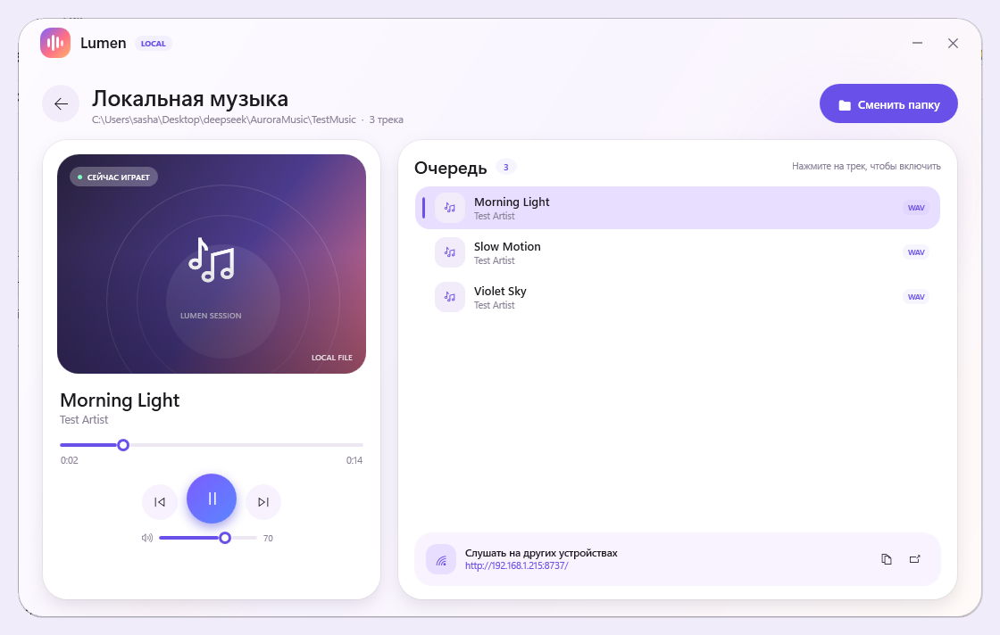
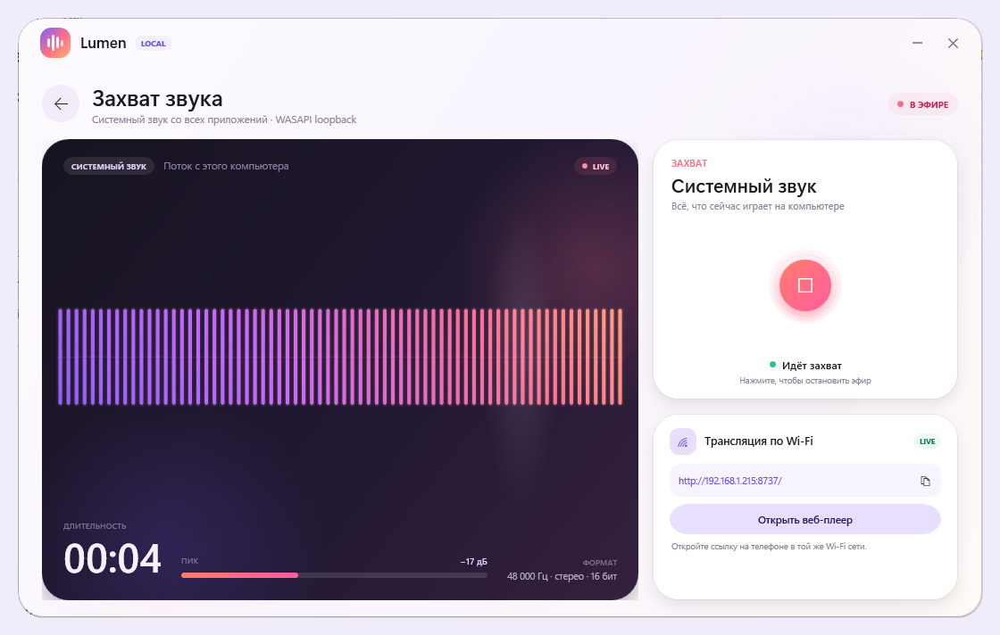

# Aurora Music

**Aurora Music** — музыкальный центр в стиле Material You 3 для Windows и Android. На компьютере это **Lumen**: локальный плеер, захват системного звука и Wi‑Fi‑трансляция. На телефоне — **Aurora Music**: приложение, которое открывает музыку с ПК, играет файлы из памяти телефона и продолжает воспроизведение в фоне.

<p align="center">
  
  
</p>

## Два приложения — один плеер

| | Windows — Lumen | Android — Aurora Music |
|---|---|---|
| **Технологии** | C# / WPF / .NET Framework 4.8 | Kotlin / WebView / MediaSession |
| **Музыка** | папка на компьютере | библиотека с ПК и файлы с телефона |
| **Главные фишки** | WASAPI loopback, HTTP‑трансляция | foreground service, уведомление и lock screen |
| **Интерфейс** | Material You 3, без сторонних UI‑библиотек | тот же веб‑плеер в нативной оболочке |

Общий веб‑плеер (`src/Net/WebUi.html`) открывается с телефона или другого ПК по адресу вида `http://192.168.1.215:8737/` и используется внутри APK. Поэтому плейлист, эфир, избранное и визуализаторы выглядят одинаково везде.

## Скриншоты

### Windows — Lumen


#### Локальная музыка



#### Захват системного звука



### Android — Aurora Music

<p align="center">
  <a href="docs/android-home.png"></a>
  <a href="docs/android-library.png"></a>
  <a href="docs/android-player.png"></a>
</p>

> Скриншоты сняты с общего веб‑плеера в мобильном размере: в APK используется тот же интерфейс.

## Возможности

### Windows — Lumen

- **Локальный плеер.** Выбор папки, рекурсивный поиск треков, очередь, обложки из ID3‑тегов MP3, перемотка, громкость и автопереход.
- **Захват системного звука.** WASAPI loopback ловит всё, что играет на компьютере: браузер, другой плеер, игру или видео.
- **Трансляция по локальной сети.** Встроенный HTTP‑сервер отдаёт веб‑плеер с плейлистом и вкладкой «Прямой эфир».
- **Material You 3.** Мягкие тональные поверхности, большие радиусы, градиенты и анимации. WPF без сторонних UI‑библиотек.
- **Портативная сборка.** Один `.exe`, которому нужен только .NET Framework 4.8.

### Android — Aurora Music

- **Музыка с ПК.** Подключение по адресу из Lumen; адрес запоминается и используется при следующих запусках.
- **Файлы с телефона.** Выбор аудиофайлов из памяти устройства или SD‑карты без подключения к компьютеру.
- **Фоновое воспроизведение.** Foreground service удерживает звук при свёрнутом приложении и заблокированном экране.
- **Управление с экрана блокировки.** Уведомление и `MediaSession`: пауза, следующий/предыдущий трек, название и исполнитель.
- **Прямой эфир.** Системный звук Windows можно слушать на телефоне в реальном времени.
- **Избранное и визуализаторы.** Сердце в полноэкранном плеере сохраняется в `localStorage`; три режима фоновой анимации.

## Скачать

- **Windows:** [Lumen 1.0](https://github.com/Gitroomcust/aurora-music/releases/tag/v1.0.0) — `Lumen-1.0-win64.zip`
- **Android:** [Aurora Music 1.0](https://github.com/Gitroomcust/aurora-music/releases/tag/android-v1.0.0) — `AuroraMusic.apk`
- [Все релизы](https://github.com/Gitroomcust/aurora-music/releases)

## Быстрый старт

### Windows

1. Скачайте `Lumen-1.0-win64.zip` и распакуйте архив в удобную папку.
2. Запустите **`Lumen.exe`**.
3. Выберите «Локальная музыка» и укажите папку с аудиофайлами или откройте «Захват звука».
4. Если Windows спросит про брандмауэр, разрешите Lumen доступ в **частных сетях**.
5. Ссылку для телефона можно скопировать из карточки «Трансляция по Wi‑Fi».

### Android

1. Скачайте `AuroraMusic.apk` из релиза и установите его (разрешите установку из неизвестных источников).
2. Запустите **Lumen** на компьютере: телефон и ПК должны быть в одной Wi‑Fi‑сети.
3. Откройте Aurora Music и в карточке **«Подключение к ПК»** введите адрес из Lumen, например `192.168.1.215:8737`.
4. Нажмите **«Подключить»** — плейлист появится в разделе «Музыка». Без ПК можно открыть файлы через «С телефона».
5. На Android 13+ разрешите уведомления, чтобы работал пульт на экране блокировки.

Подробности — в [android/README.md](android/README.md).

## Как это работает

```
Lumen (Windows)                         Aurora Music (Android)
┌──────────────────────────┐            ┌──────────────────────────┐
│ WPF UI                   │            │ Kotlin + WebView         │
│  ├─ Media Foundation     │            │  ├─ общий WebUi.html     │
│  ├─ WASAPI loopback      │  Wi‑Fi     │  ├─ PlaybackService      │
│  └─ HTTP-сервер :8737 ───┼───────────►│  └─ MediaSession         │
└──────────────────────────┘            └──────────────────────────┘
```

- **Lumen** отдаёт `/api/tracks`, `/audio/N`, `/live.wav` и сам веб‑плеер.
- **APK** загружает те же ассеты локально, а при подключении к ПК обращается к его HTTP‑серверу.
- **PlaybackService** не декодирует звук сам: WebView остаётся аудиодвижком, а сервис держит процесс живым и принимает команды с уведомления, экрана блокировки и гарнитуры.

## Горячие клавиши Lumen

| Клавиша | Действие |
|---|---|
| `Space` | пауза / воспроизведение |
| `Esc` | вернуться на главный экран |
| `Ctrl + →` | следующий трек |
| `Ctrl + ←` | предыдущий трек |

## Поддерживаемые форматы

За воспроизведение на Windows отвечает Media Foundation, поэтому список зависит от кодеков системы. Обычно работают:

`MP3`, `WAV`, `FLAC`, `M4A`, `AAC`, `WMA`, `OGG`, `OPUS`, `AIFF`.

Для лучшего результата используйте MP3/WAV/AAC. В Windows 10/11 N‑редакций может потребоваться установить Media Feature Pack. Android‑плеер воспроизводит то, что поддерживает WebView/система (MP3, FLAC, WAV, M4A и другие распространённые форматы).

## Требования

- **Windows:** Windows 10 или 11 (64‑битная), .NET Framework 4.8, звуковое устройство вывода;
- **Android:** Android 7.0+ (minSdk 24), свободное место для APK;
- **Сеть:** общая Wi‑Fi/LAN‑сеть для музыки с ПК и прямого эфира.

## Сборка из исходников

### Windows

Нужен только встроенный в Windows компилятор .NET Framework 4.x:

```powershell
# в папке AuroraMusic
Set-ExecutionPolicy -Scope Process -ExecutionPolicy Bypass
.\build.ps1
```

Появятся `dist\Lumen.exe` и `dist\Lumen-1.0-win64.zip`. Скрипт сам создаёт иконку и встраивает XAML‑ресурсы.

### Android

Нужны JDK 17, Android SDK 34 и Gradle (или Android Studio). В репозитории есть Gradle Wrapper:

```powershell
cd android
.\gradlew.bat assembleDebug
```

Либо из корня:

```powershell
.\build-apk.ps1
```

Скрипт синхронизирует `src\Net\WebUi.html` в ассеты APK, собирает `assembleDebug` и кладёт результат в `dist\AuroraMusic.apk`. Пути к JDK/SDK можно переопределить через `JAVA_HOME` и `ANDROID_HOME`.

## Структура проекта

```
src/            Lumen: WPF, Media Foundation, WASAPI, HTTP-сервер и WebUi.html
android/        Aurora Music: Kotlin, WebView, PlaybackService, Gradle
docs/           скриншоты для README
tools/          иконка и подготовка иллюстраций
build.ps1       сборка Windows
build-apk.ps1   сборка Android APK
dist/           готовые файлы (не попадает в git)
```

## Приватность и ограничения

- Всё работает локально: нет облака, аккаунтов и отправки данных в интернет.
- Захваченный звук **не записывается на диск**, а передаётся только открытым клиентам в локальной сети, пока включён захват.
- У локального веб‑сервера нет пароля: любой, кто знает адрес и находится в вашей сети, может открыть плейлист или эфир. Не включайте трансляцию в недоверенных сетях.
- Защищённый DRM‑звук (например, некоторые стриминговые сервисы) может не попадать в loopback.
- Трансляция работает в пределах локальной сети. Для доступа из интернета понадобится отдельный туннель/проброс порта — в этой версии его нет.
- Windows‑приложение не подписано цифровой подписью, поэтому SmartScreen может показать предупреждение при первом запуске. APK собран в debug‑варианте и подписан отладочным ключом.

## Лицензия

Проект распространяется по лицензии [MIT](LICENSE).

---

Сделано с любовью к музыке и Material You.  
**Lumen 1.0 · Aurora Music 1.0**
