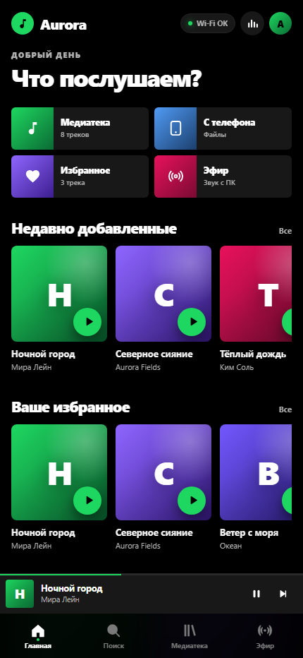
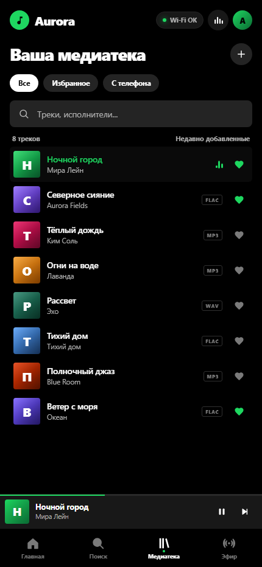
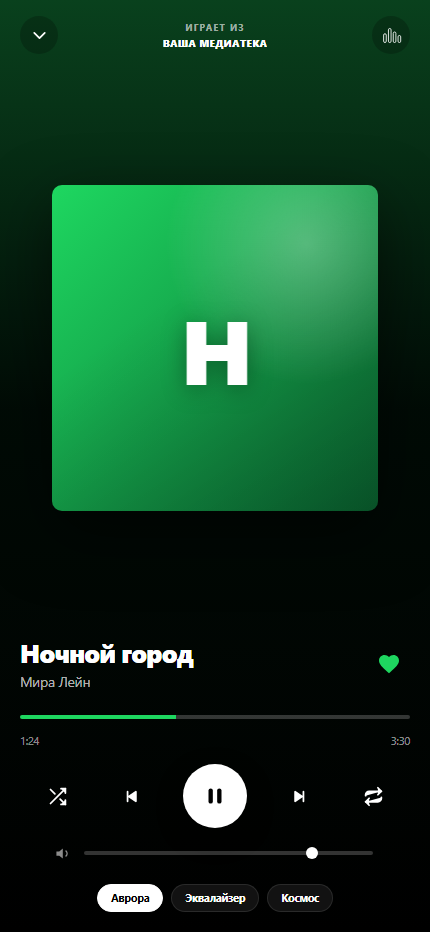

# Aurora Music для Android

Мобильная версия музыкального плеера **Aurora Music** с тёмным интерфейсом в духе Spotify: чёрные поверхности, зелёный акцент, крупная типографика, карточки, мини‑плеер и поддержка воспроизведения треков как с ПК, так и напрямую из памяти Android-устройства.

<p align="center">
  <a href="../docs/android-home.png"></a>
  <a href="../docs/android-library.png"></a>
  <a href="../docs/android-player.png"></a>
</p>

Готовый APK: [Aurora Music 1.1](https://github.com/Gitroomcust/aurora-music/releases/tag/android-v1.1.0).

## Особенности Android-версии

1. **Адаптивное масштабирование под любые экраны**:
   - Полная поддержка вырезов (notch, dynamic island), скругленных углов и жестовой панели навигации Android (`safe-area-inset`).
   - Динамическая сетка с использованием `100dvh` и масштабируемой типографики `clamp()`, обеспечивающая идеальный вид на любых диагоналях: от компактных смартфонов (320px–360px) до больших экранов (430px+) и складных устройств (Fold/Flip).
   - Нижняя навигационная панель с 4 вкладками: «Главная», «Поиск», «Медиатека», «Эфир».
   - Закрепленный мини-плеер с названием трека, прогрессом и кнопками управления; касание открывает полноэкранный плеер.

2. **Главный экран с приветствием**:
   - Приветствие зависит от времени суток: «Доброе утро», «Добрый день», «Добрый вечер» или «Доброй ночи».
   - Четыре быстрые плитки: «Медиатека», «С телефона», «Избранное» и «Эфир».
   - Подборки «Недавно добавленные», «Ваше избранное» и «Ваши плейлисты».
   - Никаких личных данных и имён учётных записей Windows на мобильном экране.

3. **Фоновый аудио-визуализатор в полноэкранном плеере**:
   - Рендеринг на `HTML5 Canvas` за полупрозрачным градиентом обложки.
   - 3 режима на выбор:
     - **«Аврора» (Северное сияние)** — многослойные хроматические синусоидальные волны Безье, плавно реагирующие на низкие и средние частоты.
     - **«Неоновый эквалайзер»** — зеркальные спектральные столбцы с физикой затухания.
     - **«Космический пульс»** — пульсирующая градиентная туманность и частицы, танцующие в такт ритму.
   - Плавная интерполяция 60 FPS, мягкое затухание в режим фонового «дыхания» при паузе и моментальная реакция на звук.

4. **Векторные иконки в духе Spotify**:
   - SVG-иконки Play, Pause, Next, Previous, Shuffle, Repeat (выкл / все / один), громкость, визуализатор, избранное и сворачивание.
   - Белая круглая кнопка Play/Pause с чёрной иконкой и зелёные активные состояния.

5. **Воспроизведение файлов с телефона**:
   - Кнопка «+» в медиатеке позволяет выбрать аудиофайлы (MP3, FLAC, WAV, M4A) напрямую из внутренней памяти телефона или SD-карты и воспроизводить их без подключения к ПК.

6. **Поиск, фильтры и избранное**:
   - Поиск по названию трека и исполнителю.
   - Фильтры «Все», «Избранное» и «С телефона».
   - Сердечко в каждой строке и в полноэкранном плеере; избранное сохраняется в `localStorage`.

7. **Интеграция с Android OS**:
   - **Фоновое воспроизведение**: foreground service удерживает процесс и звук при свёрнутом приложении и заблокированном экране.
   - **MediaSession API**: управление воспроизведением (пауза, перемотка, следующий трек), отображение названия и исполнителя на **экране блокировки (Lock Screen)** и в **шторке уведомлений Android**.
   - **Уведомление плеера**: название трека, исполнитель и кнопки «Предыдущий / Пауза / Следующий».
   - Тактильный отклик (Haptic Feedback) через `navigator.vibrate` при нажатии кнопок.

   На Android 13 и новее при первом запуске приложение попросит разрешение на уведомления — оно нужно для пульта управления музыкой на экране блокировки.

## Как запустить на телефоне

### Способ 1: Без установки (через браузер или PWA)
1. Запустите плеер на компьютере (`dist\Lumen.exe`).
2. Убедитесь, что телефон и компьютер подключены к одной Wi-Fi-сети.
3. Откройте в Chrome или другом браузере на телефоне адрес, указанный на стартовом экране ПК (например, `http://192.168.1.xxx:8737/`).
4. Нажмите в меню браузера: **«Добавить на главный экран»** (Add to Home Screen). Плеер установится как отдельное автономное приложение PWA с иконкой на рабочем столе!

### Способ 2: Сборка нативного APK (Android Studio)
1. Откройте папку `android/` в **Android Studio**.
2. Дождитесь синхронизации Gradle.
3. Подключите Android-смартфон по USB или запустите эмулятор.
4. Нажмите **Run ▶** или соберите APK:
   ```powershell
   # Windows
   .\gradlew.bat assembleDebug

   # macOS / Linux
   ./gradlew assembleDebug
   ```
   Готовый файл появится в `android/app/build/outputs/apk/debug/app-debug.apk`.

### Подключение APK к компьютеру

1. Запустите `dist\Lumen.exe` на ПК и убедитесь, что телефон и компьютер в одной Wi‑Fi‑сети.
2. Откройте установленное приложение **Aurora Music**.
3. На главном экране в карточке **«Подключение к ПК»** введите адрес из Lumen, например `192.168.1.215:8737`, и нажмите **«Подключить»**.
4. Адрес сохраняется в приложении: при следующих запусках плеер подключается к этому ПК автоматически. Изменить адрес можно там же.

Без подключения к ПК приложение продолжает работать автономно: можно открывать аудиофайлы из памяти телефона.
